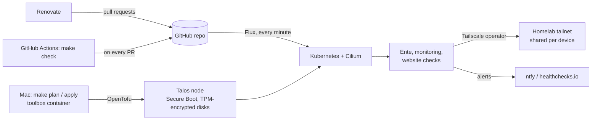

# homelab

A single-node Kubernetes cluster on a Dell Latitude 5550, running Talos Linux and managed entirely as
code from this repository: OpenTofu builds and bootstraps the node, Flux deploys everything else from
Git. Apps are reached over Tailscale; the only public part is a read-only status page:
**[homelab.andreibadescu.com](https://homelab.andreibadescu.com)**.

## What runs

| Layer | Component | Defined in |
|---|---|---|
| OS | Talos Linux (Secure Boot, TPM-encrypted disks) | `tofu/` |
| Network | Cilium (replaces Flannel and kube-proxy, enforces NetworkPolicy), Hubble Relay | `tofu/talos.tf` |
| GitOps | Flux: syncs `kubernetes/clusters/homelab` from GitHub every minute | `tofu/flux.tf` |
| Storage | local-path volumes on the encrypted `data` volume (`/var/mnt/data`) | `kubernetes/infrastructure/local-path` |
| Private access | Tailscale operator: apps get HTTPS names on the homelab tailnet (`*.junco-ulmer.ts.net`) | `kubernetes/infrastructure/tailscale` |
| Metrics | metrics-server (kubelet certificates verified) | `kubernetes/infrastructure/metrics-server`, `kubelet-cert-approver` |
| Observability | Prometheus, Alertmanager (alerts to ntfy), Grafana with dashboards as code, Loki (logs), Tempo (traces), Alloy (log collector and OpenTelemetry collector) | `kubernetes/infrastructure/monitoring` |
| Apps | Ente Photos and Locker (end-to-end encrypted), default-deny network policies | `kubernetes/apps/ente` |
| Public showcase | A separate read-only Grafana with one public dashboard, behind a Cloudflare Tunnel | `kubernetes/apps/showcase`, `kubernetes/apps/cloudflared`, `tofu/cloudflare.tf` |
| Website checks | enjoydevops.io and andreibadescu.com probed every minute (blackbox exporter) | `kubernetes/apps/website-monitoring` |

The homelab tailnet holds only the cluster's devices. People reach an app through Tailscale
**device sharing**: they see the shared app and nothing else.

## Repository layout

| Path | What |
|---|---|
| `tofu/` | OpenTofu: Talos image, machine config, install and bootstrap, Cilium, Flux bootstrap. State is encrypted and committed. |
| `kubernetes/clusters/homelab/` | Flux entry point: Flux itself, then the `infrastructure` and `apps` stages |
| `kubernetes/infrastructure/` | Platform components (one folder each) |
| `kubernetes/apps/` | Applications (one folder each) |
| `.devcontainer/` | The toolbox image every command runs in |
| `scripts/check.sh` | All repository checks (`make check`, also run by CI) |
| `docs/` | BIOS checklist, recovery runbook, external services (Tailscale, alerts, Renovate) |
| `renovate.json` | Automatic version updates |
| `credential-expiry.yaml` | When the admin credentials expire (checked monthly by a GitHub workflow) |

## How changes flow

- **Node and cluster** (Talos, Kubernetes, Cilium, Flux itself): edit `tofu/`, run `make plan` and
  `make apply`. Cilium changes also need `make sync-manifests`, because Talos only installs its
  built-in manifests when a cluster is created.
- **Everything in Kubernetes**: edit `kubernetes/` and push. Flux applies it within a minute.
- **Versions**: everything tracks the newest stable release. [Renovate](renovate.json) opens pull
  requests; Talos, Kubernetes and Flux bumps update OpenTofu and the toolbox together.

## CI/CD

- **CI** ([.github/workflows/ci.yaml](.github/workflows/ci.yaml)) runs `make check` on every pull
  request and push, inside the toolbox: OpenTofu format and validation, every Kubernetes manifest
  rendered and validated against schemas (including CRDs), a check that every Secret is
  SOPS-encrypted, yamllint, shellcheck, actionlint, gitleaks over the whole history, and Renovate's
  config validator.
- **CD for Kubernetes** is Flux: a merge to `main` is live within a minute, and a failed
  reconciliation alerts the phone.
- **CD for the node** (`tofu/`) is deliberately manual: `make plan` and `make apply` from the admin
  Mac. GitHub can't reach the home network and never holds the age key.

## Toolbox and commands

Every command runs in a container built from [.devcontainer/Dockerfile](.devcontainer/Dockerfile)
(OpenTofu, talosctl, kubectl, Helm, Flux, sops, age). Downloads are checksum-verified; `age` comes
from Debian's signed packages. The host needs only **Docker** (for example Colima) and **make**.
The toolbox mounts the repo, `~/.homelab` (admin credentials) and the age key (read-only), and also
works as a VS Code / Windsurf Dev Container.

| Command | What |
|---|---|
| `make shell` | Shell inside the toolbox |
| `make plan` / `make apply` / `make output` | OpenTofu (`make init` first on a fresh clone) |
| `make rebuild` | Install and bootstrap a node in maintenance mode again, keeping the cluster's secrets ([docs/recovery.md](docs/recovery.md)) |
| `make creds` | Write `~/.homelab/talosconfig` and `~/.homelab/kubeconfig`, and record their expiry |
| `make sync-manifests` | Push Talos's built-in manifests (Cilium, CoreDNS) to the cluster: dry run first, then asks |
| `make check-talos-config` | Validate the rendered machine config with `talosctl validate` |
| `make check` | Every repository check, exactly as CI runs them |
| `make fmt` / `make validate` | Format and validate the OpenTofu code |
| `make upgrade`, then `make lock` | Move providers to new versions and record hashes for all platforms |
| `make mac-dns` | On the admin Mac: resolve `*.ts.net` names through Tailscale only (asks for your password) |

The Makefile passes your `gh auth token` to OpenTofu through the environment (for Flux's deploy key
on GitHub). It is never written to disk.

## Day to day

- `homelab` (a shell alias for `export KUBECONFIG=~/.homelab/kubeconfig`), then `kubectl`,
  `kubectl radar` or `sofka`. These work on the home network.
- Reaching the apps (`*.junco-ulmer.ts.net`) needs the device shared to your Tailscale account and
  its name resolved. Phones use Tailscale DNS by default. On a Mac with **Use Tailscale DNS** off,
  run `make mac-dns` once: it sends only `ts.net` names to Tailscale's resolver and leaves all other
  DNS unchanged (undo: `sudo rm /etc/resolver/ts.net`).
- The admin credentials and the Cloudflare API token expire after a year. A GitHub workflow opens an
  issue 45 days before; `credential-expiry.yaml` says how to renew each one.

## Public showcase

[homelab.andreibadescu.com](https://homelab.andreibadescu.com) shows live, aggregate numbers only. How it
stays safe:

- **A separate Grafana** (`kubernetes/apps/showcase`) whose only data source is Prometheus: no logs, no
  traces, no admin data. Login, sign-up, anonymous access, snapshots and plugin management are off.
- **One public dashboard** (Grafana's shared dashboards) with fixed queries: visitors can't run their
  own queries or open anything else. The dashboard is JSON in the repository, and a sidecar publishes
  it with a fixed token after every start (Grafana keeps no state).
- **An outbound-only Cloudflare Tunnel**, defined in OpenTofu (`tofu/cloudflare.tf`): no ports open at
  home. Its routes only pass the dashboard, its API calls and Grafana's static files; everything else,
  including the login page and the API, returns 404 at Cloudflare's edge. The edge also redirects the
  bare address to the dashboard and blocks any IP sending more than 100 requests in 10 seconds.
- **Network policies**: the connector (`kubernetes/apps/cloudflared`) only reaches Cloudflare and the
  public Grafana; the public Grafana only reaches Prometheus. Restricted Pod Security, no service
  account tokens, read-only root filesystems, CPU and memory limits.

## Ente accounts

- Registration is closed (`internal.disable-registration` in `kubernetes/apps/ente/config/museum.yaml`).
  To add someone: set it to `false`, push, let them sign up, then set it back to `true`.
- The server sends no email: sign-up verification codes appear in museum's log
  (`kubectl -n ente logs deploy/ente-museum | grep -i "verification code"`).
- New accounts get 10 GB; an hourly job (`kubernetes/apps/ente/storage-limit.yaml`) raises every
  account to 100 TB (what Ente's admin tool calls "no limit").
- Apps: on the first screen tap the logo 7 times and set the server to
  `https://ente-api.junco-ulmer.ts.net`. The web apps on this server already use it.

## Monitoring and alerts

- **Grafana**: `https://grafana.junco-ulmer.ts.net` (share the `grafana` device to your account in the
  homelab tailnet). User `admin`; the password is in
  `kubernetes/infrastructure/monitoring/grafana-admin.sops.yaml` (the file's first lines show the
  command). Grafana keeps no state: its dashboards and data source come from the chart.
- **Prometheus** scrapes the API server, kubelets and containers, the node (node-exporter), Kubernetes
  objects and CoreDNS every 60 s and keeps 15 days (at most 8 GB) on the data volume.
- **Logs**: Alloy sends every pod's logs and the Kubernetes events to Loki (7 days on the data
  volume). In Grafana: Explore → Loki, for example `{namespace="ente"}`.
- **Traces and OpenTelemetry**: apps send OTLP to `alloy.monitoring.svc` (gRPC `4317`, HTTP `4318`).
  Alloy forwards traces to Tempo, logs to Loki and metrics to Prometheus. Grafana links traces to their
  logs and back. Traces are kept 7 days.
- **Dashboards** are code: JSON files in `kubernetes/infrastructure/monitoring/dashboards/` (Homelab
  overview, Logs, Traces) next to the chart's built-in Kubernetes dashboards. Edit the JSON, not
  Grafana.
- **Alerts**: warning and critical alerts go to a private **ntfy** topic. Install the ntfy app and
  subscribe to the topic in `kubernetes/infrastructure/monitoring/alertmanager-notify.sops.yaml` (it
  works like a password, so keep it private). Informational alerts stay in Grafana and Alertmanager.
  Flux reports failed reconciliations to Alertmanager too.
- **Websites**: enjoydevops.io (app and sign-in health endpoints) and andreibadescu.com are checked
  every minute from the homelab. `WebsiteDown` (critical) fires after 5 minutes of failures and
  `WebsiteCertificateExpiresSoon` (warning) 14 days before a certificate expires.
- **Dead man's switch**: the always-firing `Watchdog` alert pings healthchecks.io about every minute
  (check `homelab`, defined in `tofu/healthchecks.tf`). If the pings stop for about 15 minutes (server,
  network or Alertmanager down), healthchecks.io alerts through ntfy and by email. The ping URL is in
  the same SOPS file.

## Secrets

- Secrets are committed only as `*.sops.yaml`, encrypted with **age** ([.sops.yaml](.sops.yaml)):
  - `tofu/secrets.sops.yaml`: the OpenTofu state key, the data-volume recovery passphrase and Flux's
    age key. Encrypted to your key only.
  - `kubernetes/**/*.sops.yaml`: Kubernetes Secrets, encrypted to your key **and** the cluster's key,
    so Flux can decrypt them in the cluster.
- OpenTofu **state and plans are encrypted** (AES-GCM, enforced) with the state key, through
  `tofu/state-key.sh`.
- Your age private key lives at `~/Library/Application Support/sops/age/keys.txt` and **must be in
  your password manager**. Without it, nothing in this repository can be decrypted.

## Security

- **Boot and disks**: Secure Boot with the Sidero keys (only Sidero-signed Talos boots), and
  TPM-sealed LUKS2 on STATE, EPHEMERAL and the data volume, plus a recovery passphrase on the data
  volume. The disks can't be read on other hardware without that passphrase.
- **Admin access**: the Talos API (50000) and the Kubernetes API (6443) are reachable on the home
  network and require the client certificates in `~/.homelab`.
- **Apps**: reachable only through Tailscale. The one public page (the showcase) is published
  through an outbound-only Cloudflare Tunnel; no inbound ports are opened on the router.
- **Network policies** (enforced by Cilium), in three layers:
  - cluster-wide (`kubernetes/infrastructure/policies`): pods outside the platform's own namespaces
    can never reach the home network, the node or the Kubernetes API, whatever else they allow;
  - every app namespace (Ente, showcase, cloudflared) denies all traffic except the paths it needs;
  - the platform namespaces (monitoring, tailscale, storage, certificate approver) deny incoming
    traffic except what each component needs, so no pod can read Loki's logs or silence
    Alertmanager. Flux ships its own policies; kube-system stays open because CoreDNS and Cilium
    serve every pod.

## Adapting this to your own hardware

1. `tofu/variables.tf`: cluster name, node IP, install disk, Talos extensions.
2. `.sops.yaml`: your own age keys (yours and a new cluster key), then re-create every
   `*.sops.yaml` and delete `tofu/terraform.tfstate` (it belongs to this cluster).
3. Replace `junco-ulmer.ts.net` in `kubernetes/` with your tailnet's name, and set up the external
   services in [docs/external-services.md](docs/external-services.md).
4. Follow the BIOS checklist for your machine and the bootstrap below.

## Bootstrap and recovery

First install: [docs/bios-latitude-5550.md](docs/bios-latitude-5550.md), then boot the Secure Boot
ISO (`make output` → `iso_secureboot_url`) in maintenance mode, `make plan`, `make apply` (this wipes
the install disk), `make creds`.

Rebuilds, disk layout changes, BIOS updates and reading the data volume elsewhere:
[docs/recovery.md](docs/recovery.md).
